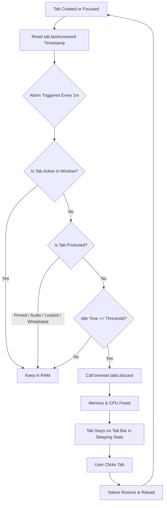

<div align="center">

# ⚡ Tab Resource Saver & Sleep Manager

### The intelligent, zero-loss tab suspender built for power users with 100+ to 1,000+ open tabs in Firefox.

[](https://addons.mozilla.org)
[](LICENSE)
[](CONTRIBUTING.md)
[](PRIVACY.md)
[](https://github.com/masterpiecedotcom/firefox-tab-resource-saver/stargazers)

<br/>

[**Explore Features**](#-key-features) • [**Quick Install**](#-installation) • [**How It Works**](#-how-it-works-under-the-hood) • [**Configuration**](#-configuration--power-user-guide) • [**Contribute**](#-contributing)

<br/>

```text
 ┌────────────────────────────────────────────────────────────────────────┐
 │  Tabs Open: 620 total (530 visible, 90 hidden)                         │
 │  🔴 Running in RAM: 18   💤 Sleeping (0% RAM): 602   Reclaimed: ~108 GB │
 └────────────────────────────────────────────────────────────────────────┘
```

</div>

---

## 📌 The Problem

If you are a researcher, developer, or digital hoarder, you know the struggle: **hundreds of open tabs you can't close because you need them later.**

- **The RAM Trap:** Even idle tabs keep running background scripts, timers, video buffers, and DOM trees. Leaving 300+ tabs open easily eats **16 GB to 32 GB of RAM**, starving your IDE, Docker containers, and OS.
- **Why Firefox Doesn't Auto-Unload Soon Enough:** By default, Firefox's internal memory manager only kicks in when your system is dangerously close to an Out-Of-Memory (OOM) freeze (`browser.tabs.unloadOnLowMemory`). It does not unload tabs simply because you haven't touched them for a few days.
- **The Tab Count Mystery:** You notice Firefox says "Close 530 tabs?" when exiting, but extensions report 620 tabs. That discrepancy is caused by hidden container tabs, background extensions, and collapsed tab trees that silently consume resources without being visible on your tab bar.

**Tab Resource Saver & Sleep Manager** solves this completely without ever losing a tab, clearing your scroll position, or closing your browsing session.

---

## ✨ Key Features

### 💤 Zero-Loss Native Tab Hibernation
Uses Firefox's native `browser.tabs.discard()` engine. When a tab goes to sleep:
* **All JavaScript execution stops completely** (0% CPU usage).
* **DOM and tab memory are flushed from RAM** (saving ~150 MB to 500 MB+ per tab).
* **The tab stays pinned or visible on your tab bar.** It never disappears.
* When you click back onto the tab, it wakes instantly and restores your exact position.

### ⏱️ Flexible Inactivity Timers (From 1 Minute to 7 Days)
Most tab suspenders force you into rigid presets (15 mins, 1 hour). We support full granularity:
* Set custom sleep thresholds in **Minutes**, **Hours**, or **Days** (up to 7 days).
* Have tabs that you only check once a week? Set the threshold to `5 days` and let the extension quietly manage background memory.
* Master **ON/OFF toggle** to suspend the automated engine whenever you are presenting or doing live work.

### 🛡️ Ironclad Anti-Sleep Protection (Whitelisting & Locking)
Never lose unsaved form progress, streaming audio, or important dashboards:
* **One-Click Tab Lock (`🛡️ Locked`):** Click the shield icon on any tab in the popup to permanently exempt it from auto-sleeping.
* **Domain Whitelisting:** Add wildcards or domains (e.g., `github.com`, `docs.google.com`, `youtube.com`) to guarantee they never sleep.
* **Auto-Protected States:** Pinned tabs and tabs actively playing audio/video are automatically excluded from hibernation.

### 🔴 Visual Hardware Indicators
* **Popup Indicator:** Running tabs feature a glowing red dot (`🔴`), while sleeping tabs show a dimmed indicator (`💤`).
* **Tab-Bar Title Injection (Optional):** Prepend `🔴 ` directly to the native browser tab title on your tab strip so you can spot heavy tabs with a single glance.
* **Toolbar Badge Counter:** The extension toolbar badge continuously displays the exact number of tabs actively resident in your physical RAM.

### 🔍 Accurate Session & Hidden Tab Breakdown
* Distinguishes between **visible tabs** and **hidden tabs** (e.g., tabs concealed by Tree Style Tab, Sidebery, Simple Tab Groups, or Multi-Account Containers).
* Instant search-as-you-type filter to locate and wake, sleep, or close any tab across all browser windows.

---

## 📊 Comparison

| Feature | Tab Resource Saver | Default Firefox | Auto Tab Discard | The Great Suspender (Chrome) |
| :--- | :---: | :---: | :---: | :---: |
| **Manifest V3 Native** | ✅ | N/A | ⚠️ (Legacy Port) | ❌ (Dead / Removed) |
| **Timer up to 7 Days** | ✅ | ❌ | ❌ | ❌ |
| **Visible vs Hidden Tab Diagnostics** | ✅ | ❌ | ❌ | ❌ |
| **1-Click Per-Tab Exemption** | ✅ | ❌ | ⚠️ Context Menu | ⚠️ |
| **🔴 Visual In-RAM Indicator** | ✅ | ❌ | ❌ | ❌ |
| **Zero External Tracking / Telemetry** | ✅ (100% Local) | ⚠️ Default Telemetry | ✅ | ❌ Sold / Compromised |
| **RAM Saved per 100 Tabs** | **~18 GB** | 0 GB | ~18 GB | ~15 GB |

---

## 🛠️ How It Works Under the Hood



### Why Firefox Tab Counts Don't Match
When Firefox prompts:
> *"You are about to close 530 tabs. Are you sure you want to continue?"*

...while the extension reports **620 tabs**, the math is simple:
$$\text{Total Tabs (620)} = \text{Visible Active Tabs (530)} + \text{Hidden Container/Tree Tabs (90)}$$

Third-party tab group managers hide tabs using the WebExtensions `browser.tabs.hide()` API. They are still active in the browser session and still consume memory until they are discarded. This extension inspects both pools and displays the exact split.

---

## 🚀 Installation

### Option 1: Load as a Temporary Add-on (Development / Testing)

1. Clone or download this repository:
   ```bash
   git clone https://github.com/masterpiecedotcom/firefox-tab-resource-saver.git
   cd firefox-tab-resource-saver
   ```
2. Open Firefox and navigate to `about:debugging#/runtime/this-firefox`.
3. Click **Load Temporary Add-on...**
4. Select the `manifest.json` file inside the repository directory.
5. The extension icon will appear in your Firefox toolbar.

### Option 2: Permanent Installation (Firefox Developer Edition / Nightly)

To keep temporary extensions installed permanently across restarts without AMO signing:
1. Open `about:config` in Firefox Developer Edition or Nightly.
2. Set `xpinstall.signatures.required` to `false`.
3. Zip the extension contents:
   ```bash
   zip -r tab-resource-saver.xpi manifest.json background.js popup.html popup.css popup.js icons/
   ```
4. Drag and drop the `.xpi` file into your Firefox window and click **Add**.

---

## ⚙️ Configuration & Power User Guide

Open the extension popup and click **⚙️ Rules** to customize your environment:

<details>
<summary><b>1. Custom Sleep Durations (up to 7 days)</b></summary>

Enter any integer and choose your scale:
* `15` **Minutes**: Recommended for laptops on battery power.
* `2` **Hours**: Recommended for daily work sessions.
* `3` **Days**: Recommended for secondary project windows and documentation research.
</details>

<details>
<summary><b>2. Whitelisting Critical Work Sites</b></summary>

Add any base domain to the whitelist box:
```text
github.com
docs.google.com
mail.google.com
jira.atlassian.net
```
All tabs matching these hostnames (including subdomains like `myproject.github.com`) will never be automatically unloaded.
</details>

<details>
<summary><b>3. Enabling the 🔴 Title Prefix on Tab Strip</b></summary>

Toggle **"Prefix Tab Bar Title with 🔴"**. 
* When active, any tab consuming system RAM will display `🔴 ` at the beginning of its page title.
* When discarded or unloaded, the prefix is cleared, giving you instantaneous visual feedback directly on your native Firefox tab bar.
</details>

---

## 📁 Repository Structure

```text
tab-resource-saver/
├── 📄 manifest.json        # Manifest V3 extension configuration & permissions
├── ⚙️ background.js       # Background alarm worker & idle evaluation loop
├── 🎨 popup.html          # Extension dashboard UI
├── 🎨 popup.css           # Modern dark-mode optimized styles
├── 📜 popup.js            # UI logic, real-time counters, search, and whitelist
├── 🖼️ icons/              # Extension icons (48x48, 96x96 PNGs)
├── 📄 LICENSE             # MIT License
└── 📄 README.md           # Documentation
```

---

## 🗺️ Roadmap

- [x] Manifest V3 compatibility with background service/event scripts
- [x] Custom idle timer ranging from minutes to 7 days
- [x] Domain-level and per-tab locking
- [x] Visible vs hidden tab session diagnostics
- [ ] Direct integration with Firefox Container Contexts (unload whole container groups)
- [ ] Keyboard shortcut commands (`Alt + Shift + U` to unload background tabs)
- [ ] Optional sync of whitelists via `browser.storage.sync`
- [ ] Graph of estimated RAM saved over time

---

## 🤝 Contributing

Contributions make the open-source community an amazing place to learn, inspire, and create. Any contributions you make are **greatly appreciated**.

1. **Fork the Project**
2. **Create your Feature Branch:**
   ```bash
   git checkout -b feature/AmazingFeature
   ```
3. **Commit your Changes:**
   ```bash
   git commit -m "Add some AmazingFeature"
   ```
4. **Push to the Branch:**
   ```bash
   git push origin feature/AmazingFeature
   ```
5. **Open a Pull Request**

Please make sure your code adheres to ESLint standards and maintains zero external runtime dependencies.

---

## 🔒 Privacy Guarantee

This extension is built on strict privacy principles:
* **NO Telemetry:** Zero analytics, tracking pixels, or remote logging.
* **NO External Requests:** The extension never communicates with external servers.
* **Local Storage Only:** All whitelist configurations and preferences remain securely stored in your local browser profile (`browser.storage.local`).

---

## 📄 License

Distributed under the **MIT License**. See [`LICENSE`](LICENSE) for more information.

---

<div align="center">

### ⭐ Star this repository if it saved your RAM!

Built with ⚡ for high-tab-count Firefox enthusiasts.

</div>
